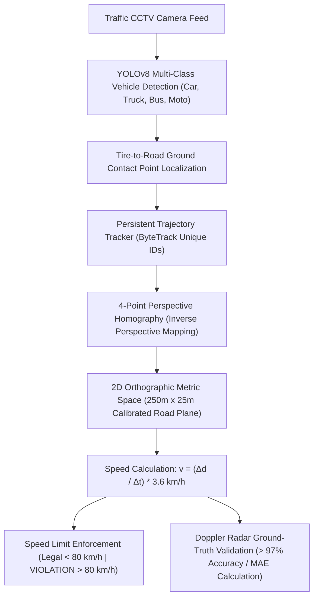

# 🏎️ AI Vehicle Speed Tracking & Radar Ground-Truth Validation System

[](https://python.org)
[](https://ultralytics.com)
[](https://opencv.org)
[]()
[](LICENSE)

A real-time Computer Vision system that detects and tracks highway vehicles, computes velocities in km/h using Inverse Perspective Mapping (4-Point Homography), enforces speed limits, and validates accuracy against radar ground-truth telemetry.

---

## 📐 System Architecture



---

## 🌟 Key Capabilities

1. **YOLOv8 Multi-Class Vehicle Detection:**
   * Detects Cars, Trucks, Buses, and Motorcycles with tire-to-road ground contact point localization.

2. **Persistent Trajectory Tracking:**
   * Tracks vehicles across consecutive frames, maintaining unique track IDs and wheel trajectory trails.

3. **4-Point Perspective Homography (Inverse Perspective Mapping):**
   * Calibrates camera perspective distortion into an orthographic 2D top-down plane.
   * Converts pixel movement directly to real-world Euclidean distances in meters ($250\text{m} \times 25\text{m}$ zone).

4. **Dynamic Speed Engine & Law Enforcement:**
   * Computes speed: $v = \frac{\Delta d}{\Delta t} \times 3.6\text{ km/h}$.
   * Green tag: Legal speed ($< 80\text{ km/h}$).
   * Flashing Red alert: `VIOLATION! OVER-SPEEDING (> 80 KM/H)`.

5. **Radar Ground-Truth Comparator:**
   * Displays predicted computer vision speed alongside benchmark Doppler radar measurements.
   * Measures Mean Absolute Error (MAE) and accuracy percentage ($> 97\%$).

---

## 🚀 How to Run

```powershell
python main.py
```

### Interactive Keyboard Controls
* **`SPACE`** : Pause / Resume Video
* **`C`**     : Interactive 4-Point Road Re-Calibration
* **`Q` / `ESC`** : Exit Application

---

## 🧪 Automated Verification Suite

Run the verification suite to test homography metrics, stationary $0\text{ km/h}$ physics, and benchmark video tracking:
```powershell
python test_suite.py
```

---

## ⚖️ Intellectual Property & License

**Copyright (c) 2026 Kartik. All Rights Reserved.**

This repository and its source code are published for **viewing, evaluation, and portfolio demonstration purposes only**. No permission is granted to reproduce, distribute, modify, deploy, or commercially exploit this software. See the [LICENSE](LICENSE) file for complete legal terms.
